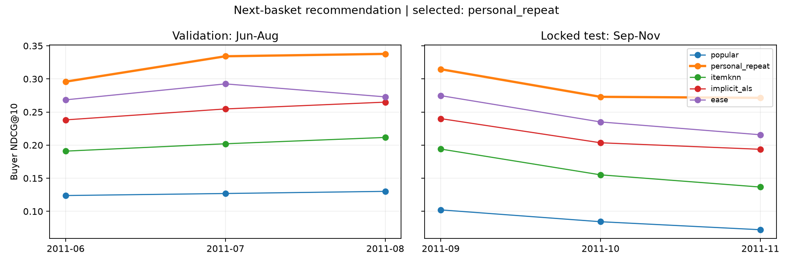

# Product recommendations for next order: comparison results

**Final adoption: Individual repeat purchase.**

Recommend 10 products each month to customers who have purchased something in the past 180 days. The answer is a different product for the next order within 30 days, allowing recommendations for previously purchased products. The main indicator NDCG@10 simultaneously measures whether the product is hit and the ranking of the hit product.

## Fair comparison of five methods

| method | Verify NDCG@10 | Verify Recall@10 | Verify Hit@10 | Test NDCG@10 | Test Recall@10 | Test Hit@10 |
|---|---:|---:|---:|---:|---:|---:|
| Popular products | 0.1270 | 6.64% | 55.45% | 0.0862 | 3.65% | 39.84% |
| Personal repeat purchase | 0.3226 | 20.01% | 80.60% | 0.2863 | 17.17% | 75.09% |
| ItemKNN | 0.2015 | 11.65% | 63.16% | 0.1619 | 8.61% | 52.66% |
| Implicit ALS | 0.2526 | 14.87% | 72.73% | 0.2124 | 11.37% | 63.87% |
| EASE | 0.2779 | 16.81% | 75.80% | 0.2418 | 13.91% | 68.97% |

Equally weighted average for each month. The above three indicators only evaluate customers with next orders; a list is generated for all qualified customers. The complete table also reports the hit rate of all customers, @ 5, product coverage, recalls of purchased/unpurchased products, and the proportion of unknown new products.

## Why choose it?

- The strongest rule during the validation period is individual repeated purchases, and the strongest learning plan is EASE.
- The average NDCG difference between the validation of the strongest learning scheme and the strongest rule: - 0.0447.
- Prior conditions: the average NDCG is at least 0.002 higher, at least 2 / 3 does not regress for months, and the average Recall lags no more than 0.005.
- Condition result: `{"ndcg_gain_at_least_002": false, "at_least_two_months_nonworse": false, "mean_recall_loss_at_most_005": false}`.
- Final parameters: `{"id": "personal_repeat_None", "method": "personal_repeat", "half_life": null}`.

## Data and time sequence

Clean transaction lines 776,579; after merging multiple lines of the same invoice and the same product, 766,089 purchase interactions are obtained. Quantity and amount do not participate in interactive weighting, reducing the impact of large wholesale orders.

| Purpose | customer months | Customer months with next order |
|---|---:|---:|
| Verification: June-August | 8,146 | 2,177 |
| Test: September-November | 8,875 | 3,025 |

1 – 5 is developed monthly, and each type of learning program has 8 set of parameters. June-August use the global product relationship selection of 6 months and 1 days ago; after selection, use 9 months and 1 days ago transactions to fit and freeze the final product relationships, and then calculate the September-Novemberly product recommendation results at once. The customer's own input only uses orders that have occurred at that time on a monthly basis, and all methods follow the same rules. 9 – 11 have been used for repurchase and amount tasks before this month, and the product answers in this round are not involved in the selection.

Candidate products are determined by all sold products within 180 days of the training period in each stage, and the methods are consistent; the same scores are sorted according to the popularity and coding during the training period; new products that appear in the test are retained in the denominator of the answer. There is no inventory data, and product listings do not represent availability at that time.

## Month by month effects and difficulties

| month | Purpose | There is a next customer | NDCG@10 | Recall@10 | Hit@10 | Proportion of answers among candidates | Purchased item Recall | Unbought item Recall |
|---|---|---:|---:|---:|---:|---:|---:|---:|
| 2011-06 | Verify | 745 | 0.2958 | 18.28% | 78.12% | 93.66% | 45.77% | 0.08% |
| 2011-07 | Verify | 717 | 0.3342 | 20.86% | 80.06% | 89.65% | 46.82% | 0.09% |
| 2011-08 | Verify | 715 | 0.3378 | 20.88% | 83.64% | 87.65% | 44.49% | 0.35% |
| 2011-09 | test | 903 | 0.3146 | 18.76% | 76.41% | 95.10% | 48.14% | 0.12% |
| 2011-10 | test | 900 | 0.2729 | 15.49% | 72.67% | 89.08% | 42.59% | 0.18% |
| 2011-11 | test | 1,222 | 0.2714 | 17.25% | 76.19% | 88.50% | 41.12% | 0.12% |

Bought/Not Bought refers to whether the item was purchased in the past 180 days. The next order may contain many products, so the Recall of recommended 10 pieces may be lower; Hit only requires at least one hit, and cannot be used alone to claim that the recommendation is very accurate.

Validation period 500 customer group paired sampling (the strongest learning plan minus the strongest rule):
- ndcg_ 10: - 0.0447, 95% customer sampling interval [- 0.0533, - 0.0357 ].
- recall_ 10: - 0.0319, 95% customer sampling interval [- 0.0394, - 0.0247 ].
Sampling is an internal robustness check after selection and is not a guarantee of new month results. ALS Additional seed results are available in als_seed_monthly.csv.

## Open and reproduce

`python -B -m pipelines.recommendation_baselines`

`python -m streamlit run app/dashboard.py` → **Product recommendations** → Select date and customer.

recommendations.csv is used for pages and exports and does not contain future orders, hits or answers. validation_labels.csv/test_labels.csv and customer-by-customer indicators are only used for offline verification; locked_selection.json saves selection, parameters and model hashes, and tuning_comparison.csv saves all 30 group configurations.

Algorithm basis: [ItemKNN](https://www.ra.ethz.ch/CDstore/www10/papers/519/) · [Implicit feedback ALS](https://yifanhu.net/PUB/cf.pdf) · [EASE](https://arxiv.org/abs/1905.03375).
