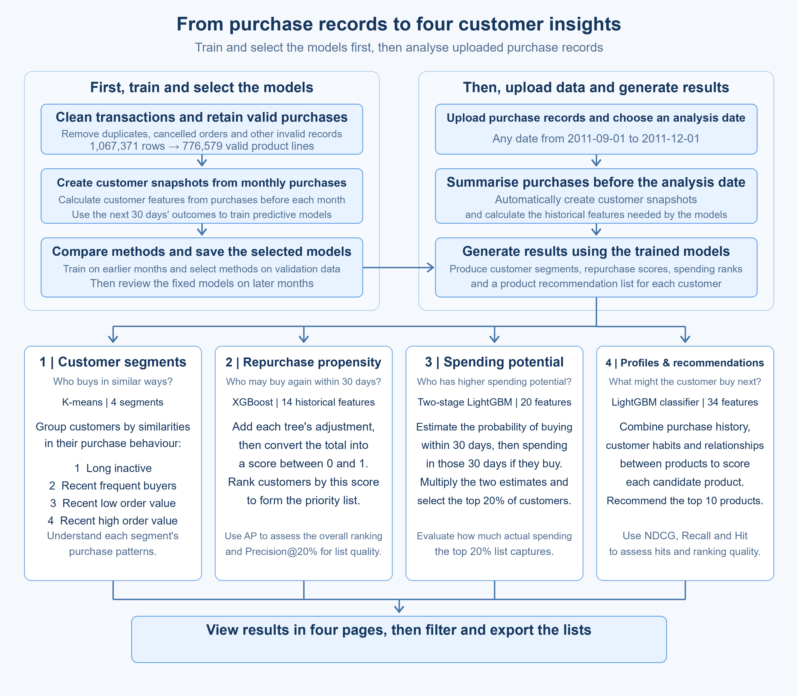

# E-commerce Customer Analytics: Project Learning Guide

This guide follows the project from purchase records to customer segments, repurchase scores, spending-potential ranks, and product recommendations. Each stage explains its purpose before introducing the models and metrics.

## The big picture: what does the system help a retailer answer?

A retailer has many orders but needs a clearer understanding of its customers: how do they buy, who is likely to return, who has higher spending potential, and what should be recommended? These questions define the four project goals.

| Goal | Question | Page output |
| --- | --- | --- |
| Customer segmentation | Which customers have similar purchase habits? | Four segments and their purchase characteristics. |
| Repurchase within 30 days | Who is more likely to buy again? | Repurchase scores and a priority list. |
| Spending-potential ranking | Who has higher spending potential over the next 30 days? | Customer ranks and a top-20% priority list. |
| Profiles and product recommendations | Does a customer tend to replenish familiar products or try new ones? What might they buy next? | A purchase-habit profile and ten candidate products. |

The system is designed for retail operations and customer analysts. Purchase records are the input; customer and product lists that staff can review and export are the output.

The guide has seven stages. The first three prepare shared data. The next stages explain the models and scores, followed by their integration into the interface.

## Stage 1 | Understand the data and define the customers

The project uses **UCI Online Retail II**, real transactions from a UK retailer covering **2009-12-01 to 2011-12-09**, including wholesale purchases.

| Original file | Product transaction lines |
| --- | ---: |
| online_retail_II_2009-2010.csv | 525,461 |
| online_retail_II_2010-2011.csv | 541,910 |
| Total | **1,067,371** |

Both files have eight fields: invoice number, product code, description, quantity, purchase time, unit price, customer ID, and country.

**One row describes a product on an invoice.** If an invoice contains two products, it normally has two rows. A customer who shops repeatedly appears on multiple invoices. The 1,067,371 rows therefore count product transaction lines.

The analysis focuses on identifiable customers with at least one eligible purchase in the 180 days before the analysis date.

From these records, the system calculates how often customers buy, how much they spend per order, and whether they repeatedly buy familiar products or try different ones.

## Stage 2 | Clean the transactions into usable purchase records

The next step is to identify eligible product purchases, which provide a consistent basis for order counts and spending.

1. **Merge the two CSV files and standardize their formats.** Parse dates, customer IDs, quantities, and prices consistently.
2. **Remove exact duplicate rows.** Keep different products on the same invoice.
3. **Identify eligible purchases.** Exclude missing customer IDs, cancelled invoices, non-positive quantities or prices, and non-product entries such as postage and test records.
4. **Reconcile the counts.** Record exclusion reasons so every source row is accounted for.

Of **1,067,371 rows**, **776,579 eligible product transaction lines** remain and **290,792 are excluded**. A line's amount is quantity × unit price; amounts can then be aggregated by customer, invoice, and time.

## Stage 3 | Build customer snapshots and training labels

Cleaned transactions still describe individual products. To compare customers, we summarize each customer's transactions into a consistent set of features.

### 3.1 What is a customer snapshot?

**A customer snapshot is one row summarizing a customer's purchase history as of a particular date.** For an analysis date of December 1, only earlier transactions contribute to its features.

Here is customer **12347's real base snapshot on 2011-12-01**. All eight features describe information already available at that point.

| Base feature | Customer's value | Calculation |
| --- | ---: | --- |
| Days since last purchase | 31 days | Calendar-day difference between the analysis date and the latest purchase date. |
| Orders in the past 180 days | 3 | Count distinct eligible invoices. |
| Spending in the past 180 days | £2,261.75 | Sum eligible product-line amounts in that window. |
| Average order value | £753.92 | £2,261.75 ÷ 3, rounded to two decimals. |
| Distinct products in the past 180 days | 61 | Count distinct purchased product codes. |
| Orders in the past 30 days | 0 | Count eligible invoices in the 30 days before analysis. |
| Orders in the past 90 days | 1 | Count eligible invoices in the 90 days before analysis. |
| Visible customer history | 396 days | Calendar-day difference from the first visible purchase in the available data. |

For December 1, the 180-day window is **2011-06-04 through 2011-11-30**. First-purchase dates and cumulative historical spending can require older records, so uploads should contain the complete available purchase history.

These eight features form a shared starting point. Repurchase models add purchase-rhythm features; spending models add amounts from shorter windows. Later stages explain these additions.

### 3.2 What is a label?

A training model also needs an answer describing what actually happened after the snapshot. This answer is called a **label**.

| Task | Training or evaluation answer |
| --- | --- |
| Repurchase prediction | At least one eligible purchase in the following 30 days: 1; otherwise: 0. The field is `repurchase_30d`. |
| Spending-potential ranking | Total eligible spending in the following 30 days; zero if there is no purchase. |
| Product recommendations | Distinct products in the customer's next order within the following 30 days. |
| Customer segmentation | Groups are formed from similarity in historical features. |

**Features describe earlier activity; labels describe subsequent outcomes.** Training learns their relationship, prediction produces scores from a new snapshot, and evaluation compares those predictions with actual labels.

### 3.3 How are training, validation, and testing arranged?

For offline modeling, a batch of snapshots is generated on the first day of each month. Earlier months support training; later months support comparison and evaluation. There are **54,040 customer-month snapshots for 5,622 distinct customers**. A customer can appear in more than one month.

The snapshot table has 15 fields: eight base features, one repurchase label, and six supporting fields such as dates and customer identifiers. Each row represents one customer at one point in time.

| Split | Snapshot months | Rows | Purpose |
| --- | --- | ---: | --- |
| Training | June 2010-May 2011 | 37,019 | Learn purchase patterns. |
| Validation | June-August 2011 | 8,146 | Compare features, models, and parameters. |
| Test | September-November 2011 | 8,875 | Check the chosen approach. |

For example, when scoring the 30 days starting October 1, September's purchases contribute to the October snapshot. The saved model then scores that updated snapshot. **The customer features change with the analysis date; the trained model is reused.**

Below, September-November results are called the **test-period review**. Metrics are calculated from predictions and actual transactions in the corresponding split.

## Stage 4 | Compare clustering methods and identify four purchase patterns

Customer segmentation groups customers with similar historical purchase behavior.

### 4.1 Which features and algorithms are compared?

Segmentation uses five features: days since last purchase, orders in the past 180 days, average order value, product breadth per order, and the share of orders placed in the latest 90 days.

- **Product breadth per order = distinct products in 180 days ÷ orders in 180 days.**
- **Recent order share = orders in 90 days ÷ orders in 180 days.** This shows how much activity is concentrated in recent months.

Large feature values are compressed and features are scaled to comparable ranges. All algorithms receive the same information.

| Algorithm | How it groups customers | Reason for comparison |
| --- | --- | --- |
| K-means | Finds a center for each group and assigns customers to their nearest center. | Suitable for numerical purchase features, with interpretable group centers. |
| Bisecting K-means | Starts with a split into two groups and progressively divides groups. | Tests whether a hierarchical splitting process gives more stable segments. |
| GMM | Represents customers with multiple probability distributions and estimates membership in each group. | Tests whether groups with different shapes and sizes suit the data better. |

Each algorithm tries **2-6 clusters**. Some customers are held out for evaluation, and training customers are resampled to check stability.

### 4.2 How are the groups evaluated, and why choose four?

The **silhouette score** checks whether customers are close to their own group and separated from other groups:

**Silhouette = (b − a) ÷ max(a, b).**

Here, a is a customer's average distance to their own group, and b is their average distance to the nearest other group. Scores are then averaged across evaluation customers.

Its range is **−1 to 1; higher is generally better**. Values near zero indicate overlapping boundaries. Stability is measured by **ARI**, which compares whether pairs of customers remain together or apart across clustering runs, adjusting for agreement expected by chance. ARI = 1 means identical groupings; around zero means chance-level agreement, and negative values are possible. Group sizes and interpretable profiles also matter.

| Approach | Silhouette | Stability ARI |
| --- | ---: | ---: |
| K-means, 2 clusters | 0.3580 | 1.0000 |
| K-means, 3 clusters | 0.3227 | 0.9883 |
| **K-means, 4 clusters** | **0.3056** | **0.9525** |
| Bisecting K-means, 4 clusters | 0.2885 | 0.9487 |
| GMM, 4 clusters, better silhouette configuration | 0.2195 | 0.8047 |

Two groups mainly distinguish long-inactive customers from recent buyers and have the highest silhouette. Four groups reveal further differences in purchase frequency and order value. Among four-cluster approaches, K-means is more stable and better separated. Five or six groups provide finer divisions but have silhouettes around 0.266.

The final choice is **K-means with four clusters**, balancing useful detail, stability, and interpretability.

### 4.3 What do the segment names mean?

| Display name | Main characteristic |
| --- | --- |
| Group 1: Long inactive | A relatively long time since the latest purchase. |
| Group 2: Recent frequent buyers | Recent activity and relatively many orders. |
| Group 3: Recent low order value | Recent activity and relatively low average order value. |
| Group 4: Recent high order value | Recent activity and relatively high average order value. |

**The algorithm forms groups first; people name them afterward based on their profiles.** Names summarize each group's main characteristics. A customer's assignment can change as their purchase behavior changes.

For K-means, assignment compares distances to the centers, using the sum of squared differences across scaled features, and selects the nearest center.

Two spending measures should be distinguished: **total spending describes an entire period; average order value describes spending per order**. Frequent buyers may have higher total spending because they place more orders. The high-order-value group is distinguished by larger average orders. A group's displayed share is **customers in that group ÷ customers in the current analysis**.

## Stage 5 | Train the repurchase model and generate customer priorities

Segmentation describes purchase patterns. Predicting who will buy again requires learning the relationship between historical features and actual repurchase labels.

### 5.1 Which features and models are compared?

Three feature groups test whether additional information helps.

| Feature group | Contents | Purpose |
| --- | --- | --- |
| Base, 8 features | The purchase features in Stage 3. | A common starting point. |
| Base + trend, 11 features | Adds recent order share, purchase-rate change, and a flag for at least 90 days of history. | Distinguishes customers whose purchasing is increasing or decreasing. |
| Base + trend + rhythm, 14 features | Also adds active 30-day periods in the past six months, the interval between the last two purchases, and its validity flag. | Distinguishes regular activity from occasional bursts of purchases. |

All additions come from purchases before the analysis date. Each feature group is compared across four models, giving 12 combinations.

| Model | Plain-language principle | Purpose |
| --- | --- | --- |
| Logistic regression, LR | Learns feature weights and combines them into a score. | Checks how far a simple weighted model can go. |
| Spline logistic regression | Allows effects such as purchase recency to vary smoothly. | A change from 5 to 10 days may matter differently from a change from 100 to 105 days. |
| XGBoost | Adds small trees that progressively correct predictions. | Learns combinations of frequency, timing, and spending. |
| LightGBM | Another GBDT implementation that adds small trees progressively. | Compares two tree-building approaches on this dataset. |

Forward validation within the training period selects model complexity. June-August then compares the resulting combinations. Numerical tabular data and potentially nonlinear purchase patterns motivate the comparison from weighted models to small tree ensembles.

| Model using 14 features | Validation AP | Precision@20% |
| --- | ---: | ---: |
| LR | 0.5931 | 60.02% |
| Spline LR | 0.5953 | 60.58% |
| LightGBM | 0.5997 | 60.33% |
| **XGBoost** | **0.6009** | **60.64%** |

The final choice is **14 features + XGBoost**. Selection considers forward-validation AP, Precision@20%, and the base LR comparison. XGBoost and LightGBM have similar validation AP; XGBoost is about 0.0013 higher in this comparison.

### 5.2 How does the model calculate a customer's score?

Each XGBoost tree follows the customer's features to a leaf and contributes a correction learned during training. The model combines these corrections and converts the total to a score between 0 and 1.

**Raw total F = initial value + weighted sum of tree corrections.**

**Repurchase score s = 1 ÷ (1 + exp(−F)).**

When F = 0, the score is 0.5. A larger F gives a higher score. The key idea is that trees learn corrections and combine them into one score.

Tree conditions and leaf values are learned from training features and 0/1 labels.

Customer 12347's score on 2011-12-01 is approximately **0.3326**. A higher score indicates stronger model-estimated repurchase propensity. The page sorts customers by this continuous score to help users prioritize their review.

### 5.3 How do we evaluate the scores?

After scoring, customers are ranked from high to low and checked against actual labels. In the September-November test-period review, there are 8,875 customer-month records and 3,025 actual repurchases. Selecting the top 20% each month gives 1,776 places; XGBoost identifies 1,176 repurchase records.

| Metric | Calculation and meaning | Range / preferred direction | XGBoost |
| --- | --- | --- | ---: |
| AP | Summarizes precision as actual repurchases are found along the ranking; checks whether they appear near the top. The example below explains the calculation. | 0-1; higher is better | **0.6201** |
| ROC-AUC | Compares every repurchase/non-repurchase pair and calculates how often the repurchase has the higher score; ties count as half correct. | 0-1; higher is better; 0.5 is approximately random | **0.7204** |
| Precision@20% | Repurchases in the list ÷ records in the list: 1,176 ÷ 1,776. | 0-100%; higher is better | **66.22%** |
| Recall@20% | Repurchases in the list ÷ all actual repurchases: 1,176 ÷ 3,025. | 0-100%; higher is better | **38.88%** |
| Lift@20% | List repurchase rate ÷ overall repurchase rate. Overall rate = 3,025 ÷ 8,875 = 34.08%. | At least 0; higher is better; 1 equals the overall rate | **1.943×** |
| Brier | Average of (score − actual 0/1 outcome)² across records. | 0-1; lower is better | **0.1928** |

**AP and ROC-AUC evaluate ranking; Brier evaluates the numerical scores against actual outcomes.**

Consider five records ranked from highest to lowest score. An actual outcome of **1 means repurchase; 0 means no repurchase**.

| Rank | Customer | Score | Actual outcome |
| ---: | --- | ---: | ---: |
| 1 | A | 0.9 | 1 |
| 2 | B | 0.8 | 0 |
| 3 | C | 0.7 | 1 |
| 4 | D | 0.4 | 1 |
| 5 | E | 0.1 | 0 |

**① AP: when we find a repurchaser, how many customers above that point also repurchased?**

Moving down the list, calculate precision whenever an actual repurchaser appears:

- At A, rank 1: one of one repurchased, so **1 ÷ 1 = 100%**.
- At C, rank 3: two of three repurchased, so **2 ÷ 3 ≈ 66.67%**.
- At D, rank 4: three of four repurchased, so **3 ÷ 4 = 75%**.

Average these three values:

**AP = (1 + 2/3 + 3/4) ÷ 3 ≈ 0.8056.**

If all three repurchasers occupied the first three places, all three precisions would be 100% and AP would be 1. **Earlier concentration of repurchasers generally gives higher AP.** The implementation handles tied scores together and weights precision by each increase in recall.

**② ROC-AUC: does a repurchaser rank above a non-repurchaser?**

Three repurchasers and two non-repurchasers give **3 × 2 = 6 pairs**.

| Repurchaser | Comparison with non-repurchasers B and E | Correct pairs |
| --- | --- | ---: |
| A: 0.9 | Above B's 0.8 and E's 0.1 | 2 |
| C: 0.7 | Below B, above E | 1 |
| D: 0.4 | Below B, above E | 1 |

Four pairs are correctly ordered:

**ROC-AUC = 4 ÷ 6 ≈ 0.6667.**

A tie counts as half correct. AUC = 1 means every pair is ordered correctly; 0.5 is approximately random.

**AP checks precision along the list; AUC checks the relative order of all positive-negative pairs.** The project's AUC of 0.7204 corresponds to about 72.04% correctly ordered pairs, counting ties as half.

**③ Brier: how far is each score from its actual 0/1 outcome?**

For each record:

**Squared error = (score − actual outcome)².**

For example:

- A scores 0.9 and repurchases: (0.9 − 1)² = **0.01**.
- B scores 0.8 and does not repurchase: (0.8 − 0)² = **0.64**.

B receives a larger penalty because its high score disagrees with the outcome. Averaging all five squared errors:

**Brier = (0.01 + 0.64 + 0.09 + 0.36 + 0.01) ÷ 5 = 0.222.**

**Lower Brier means lower average squared error.** Even with the same ranking, assigning 0.6 rather than 0.9 can change Brier. The project's 0.1928 is the mean squared error over all test-period review records.

On the same data, base-eight-feature LR achieves **AP 0.6064** and **Precision@20% 63.96%**, identifying 1,136 repurchase records. XGBoost identifies 40 more customer-month records with the same list size. These are customer-month counts: the same customer in different months counts as a separate record.

Together, these metrics describe overall ranking, top-20% list quality, coverage of actual repurchasers, and numerical score error.

## Stage 6 | Rank spending potential and recommend products

The next two tasks complement repurchase scoring: estimate which customers may contribute more spending and identify products they might buy next.

### 6.1 Spending potential: rank customers for the next 30 days

This task uses **20 historical features**: the base eight plus twelve additions, including spending over 30/60/90 days, latest and largest order amounts, active purchase days, and cumulative historical spending. The label is actual spending in the following 30 days.

| Method | Approach and reason for comparison |
| --- | --- |
| Past 30/90/180-day spending | Rank by past spending; straightforward business comparisons. |
| Direct LightGBM amount model | Predict total spending in the next 30 days using a Tweedie objective. |
| Direct XGBoost amount model | Also predicts total 30-day spending with a Tweedie objective, trained and compared separately. |
| Two-stage LightGBM | Estimates whether a purchase occurs and the spending amount conditional on a purchase. |

The **Tweedie objective** is the amount model's training loss: a rule for measuring prediction error and guiding subsequent trees.

The selected approach is **two-stage LightGBM**. Its purchase classifier is separate from the repurchase page's XGBoost. The first stage estimates purchase probability p; the second estimates total 30-day spending conditional on purchasing, m.

**Raw spending-potential score = p × m.**

For example, p = 0.6 and m = £500 give £300. **This is the model's expected spending estimate for the next 30 days.** Customers are ranked by this value, and the page displays their spending-potential ranks.

Each batch selects its top 20%. The primary metric is:

**Spending capture = actual next-30-day spending of the top 20% ÷ actual next-30-day spending of all customers in the batch.**

It ranges from 0% to 100%; higher means the same number of places captures more actual spending.

If 100 customers spend £10,000 and the selected 20 spend £7,000, capture is 70%.

| Method | June-August validation capture | September-November review capture |
| --- | ---: | ---: |
| Past 180-day spending rule | 71.37% | 67.45% |
| Past 90-day spending rule | 67.39% | 64.56% |
| Past 30-day spending rule | 56.14% | 55.95% |
| Direct LightGBM amount model | 73.01% | 70.23% |
| Direct XGBoost amount model | 72.80% | 70.45% |
| **Two-stage LightGBM** | **73.28%** | **70.23%** |

Capture is calculated separately for each month and then averaged equally across the three months. The two-stage model improves on the strongest rule by **1.91 percentage points in validation** and satisfies the monthly-performance and customer-resampling selection conditions. The approach is selected using June-August, then reviewed on September-November, where its gain over the rule is about **2.78 percentage points**.

After selection, the final ranking model is fitted on training and validation samples whose labels are fully observed before September 1. MAE is a supporting metric: calculate each customer's absolute difference between predicted and actual spending, then average.

**MAE = sum of absolute spending errors ÷ number of customer records.**

It is at least zero, measured in pounds, and lower is better.

| Method | June-August validation MAE (£) | September-November review MAE (£) |
| --- | ---: | ---: |
| Past 180-day spending rule | 203.66 | 263.47 |
| Past 90-day spending rule | 209.43 | 270.68 |
| Past 30-day spending rule | 244.30 | 336.68 |
| Direct LightGBM amount model | 187.66 | **252.10** |
| Direct XGBoost amount model | **187.43** | 252.12 |
| Two-stage LightGBM | 187.91 | 253.75 |

MAE gives equal weight to customer-month records within each period. For amount estimation, the rules use past 180-day spending ÷ 6, past 90-day spending ÷ 3, or past 30-day spending.

**Conclusion:** all three learned models have lower amount errors than the three rules in both periods. Direct XGBoost has the lowest validation MAE; direct LightGBM has the lowest review MAE. Two-stage LightGBM reduces review MAE by about **£9.71** compared with the 180-day rule. It is selected because it has the highest validation top-20% spending capture and meets the other selection conditions. **For the current goal of selecting a customer list, prioritizing capture is appropriate. MAE measures amount error; spending capture evaluates the priority ranking.**

### 6.2 Profiles and recommendations: understand buying habits, then produce a top ten

**A customer profile summarizes a person's historical behavior in an understandable form.** Here, it describes purchase habits: frequency, product variety, repeat purchases versus new products, and concentration on familiar items.

Segmentation describes patterns shared by a group; a profile describes an individual customer. The interface uses these statistics to explain buying habits, and experiments test whether profiles improve recommendations.

Profiles are built in four steps:

1. **Collect historical purchases.** Use the 180 days before the analysis date and order them by time.
2. **Build purchase baskets.** Combine purchases by the same customer at the same timestamp. Count each product once in that basket: ten identical cups represent one product type.
3. **Calculate habits.** Count purchases and distinct products, compare each basket with products bought earlier, and calculate repeat-product shares and product concentration.
4. **Create one profile row per customer.** Use the statistics in the interface and models; recalculate them for a new analysis date.

**① Repeat-product share**

Each order is compared with **all products bought before that order**. The set of previously purchased products grows over time. Suppose the following purchases all occur within the 180-day window:

| Purchase | Products | Which products were already purchased? | Repeat-product share |
| --- | --- | --- | ---: |
| First | A, B | Establish purchase history: A, B. | Starting point |
| Second | A, C | A is familiar; C is new. Update history to A, B, C. | 1 ÷ 2 = 50% |
| Third | C, D | C appeared in the second purchase; D is new. | 1 ÷ 2 = 50% |

The first basket establishes history. Later baskets use the accumulated history, so C counts as a repeat product in the third purchase even though it was absent from the first.

Average the proportions from the second purchase onward:

**Historical repeat-product share = (50% + 50%) ÷ 2 = 50%.**

This customer's profile has three purchases and four distinct products, with familiar products making up half of later baskets on average. This share concerns product types; quantities and spending are calculated separately.

**② Top-three product concentration**

**Top-three concentration = total appearances of the three most frequently purchased products ÷ total product appearances.**

Each product counts once per purchase. A higher share means purchasing is concentrated on fewer familiar products. The page shows it in **Profile details**.

The item-model experiments also use recent repeat-product share, its change, mean basket size, purchase recency, and related measures, forming **ten profile features** from the same historical records.

Profiles describe how customers buy; recommendation predicts what they might buy next. Two rounds of experiments connect these ideas.

**Inputs and outputs of the two rounds**

| Comparison | Round 1: five recommendation methods | Round 2: four feature groups × three models |
| --- | --- | --- |
| Source | Purchases in the 180 days before analysis. | The same historical purchase records. |
| Prepared input | **Customer-product purchase-count matrix:** who bought what, and how many times. | **Customer-candidate-product feature table:** purchase counts, recency, popularity, and group-specific profile or EASE features. |
| Learning | Rules calculate statistics; ItemKNN, ALS, and EASE learn from purchase relationships. | LR or LightGBM learns which customer-product combinations are more likely to appear in the next order. |
| Output | Five methods each generate a top ten per customer. | Twelve combinations each generate a top ten per customer. |

**Where are these inputs stored?**

| Input | Location and storage |
| --- | --- |
| Customer-product purchase counts | Built from [clean_transactions.csv](../data/processed/customer_snapshot_pipeline/clean_transactions.csv). At runtime, purchases before the analysis date form a sparse matrix: rows are customers, columns are products, and cells are purchase counts within 180 days. |
| Customer-candidate-product features | Sampled training data are saved in [training_samples.joblib](../recommendation/outputs/item_v3_1/training_samples.joblib). Each row represents a customer and a product, with the 34 full features, a 0/1 label, and customer/product identifiers. Training selects the features required by groups A-D. |

The first input is built for the analysis date. The second stores sampled historical training data; validation and recommendation calculate candidate features for their own dates. A `.joblib` file is read with Python. Feature lists are in [feature_manifest.json](../recommendation/outputs/item_v3_1/feature_manifest.json).

[profiles.csv](../recommendation/outputs/item_v3_1/profiles.csv) contains one profile per customer and analysis date, supplying ten profile features to groups B and D. The customer-product table combines these profiles with each product's purchase history and popularity.

**Round 1: compare five recommenders**

| Method | Recommendation approach | Reason for comparison |
| --- | --- | --- |
| Popular products | Recommend products popular across customers. | Measures the value of overall popularity. |
| Personal repeat purchase | Prioritize products repeatedly bought by that customer in the past 180 days. | A competitive business rule for replenishment and wholesale transactions. |
| ItemKNN | Find similar products often purchased by the same customers. | Uses product-to-product purchase relationships. |
| Implicit ALS | Learn customer preferences and product factors from who bought what. | Uses purchases as preference signals. |
| EASE | Learn overall product associations. | Provides another model suited to sparse purchase records. |

All methods recommend ten products to the same customers from the same candidate catalog. Their lists are checked against the next order within 30 days, using the same customers, catalog, and evaluation months.

The primary metric, **NDCG@10**, rewards both matching products and placing them earlier. Recall@10 measures coverage of next-order products; Hit@10 measures whether at least one product matches; unseen-product Recall@10 measures coverage of products not bought in the preceding window. Section 6.3 defines them.

**Round 1 results: June-August 2011 validation**

| Method | NDCG@10 | Recall@10 | Hit@10 | Unseen-product Recall@10 |
| --- | ---: | ---: | ---: | ---: |
| Popular products | 0.1270 | 6.64% | 55.45% | 3.53% |
| **Personal repeat purchase** | **0.3226** | **20.01%** | **80.60%** | 0.17% |
| ItemKNN | 0.2015 | 11.65% | 63.16% | 4.91% |
| Implicit ALS | 0.2526 | 14.87% | 72.73% | 3.34% |
| EASE | 0.2779 | 16.81% | 75.80% | 2.28% |

**Round 1 conclusion:** personal repeat purchase leads on overall NDCG, Recall, and Hit, so it becomes the main comparison for later experiments. EASE has the highest NDCG among the three learned recommenders and supplies product-association scores in the next round. Personal repeat purchase's unseen-product Recall of 0.17% motivates combining purchase habits and product associations to support both replenishment and discovery.

**Round 2: compare item-level scoring models and four feature groups**

The next task is more specific: **score each customer-product pair and select the customer's ten highest-scoring products**. The label is whether that product appears in the next order within 30 days. Features use only purchases before the analysis date.

Groups A-D test the contributions of customer profiles and product associations.

| Group | Information given to the model | Example |
| --- | --- | --- |
| **A: base, 15 features** | Whether the customer bought the product, purchase count, recency, purchase intervals, and product popularity. | The customer bought this cup three times, most recently 20 days ago. |
| **B: base + profiles, 31 features** | A + ten purchase-habit features + six interactions. | The same three cup purchases may mean something different for a regular replenisher and someone who often tries new products. |
| **C: base + EASE, 17 features** | A + EASE association score and a missing-signal flag. | The customer has not bought a plate but has bought associated cups; EASE supplies an association score. |
| **D: full, 34 features** | A + B's profile and interaction additions + C's EASE signals + repeat-product share × EASE score. | Combines overall replenishment habits, the product's purchase history, and support from other product relationships. |

An interaction combines two pieces of information. For example, **repeat-product share × previously purchased flag** links a customer's general habits with a particular product. Group D combines these signals on top of the shared base features.

Each group uses **LR, a LightGBM classifier, and a LightGBM ranker**, giving **4 × 3 = 12 combinations**. In groups C and D, EASE first supplies a feature; the scoring model then learns the final ranking. This differs from ranking directly by EASE scores in Round 1.

Comparisons use the same customers, training samples, candidate products, and evaluation months. For a given model family, all groups share the same parameters. **B versus A and D versus C test profile additions; C versus A and D versus B test EASE additions.** Previously purchased flags, order counts, and missing-profile information are also recorded.

**Round 2 results: June-August 2011 validation**

Personal repeat purchase from Round 1 remains the shared comparison.

| Feature group | Scoring model | NDCG@10 | Recall@10 | Hit@10 | Unseen-product Recall@10 |
| --- | --- | ---: | ---: | ---: | ---: |
| Reference | Personal repeat purchase | 0.3226 | 20.01% | 80.60% | 0.17% |
| A: base | LR | 0.3408 | 20.85% | 82.74% | 0.24% |
| A: base | LightGBM classifier | 0.3415 | 20.89% | 82.52% | 0.23% |
| A: base | LightGBM ranker | 0.0701 | 3.36% | 35.86% | 2.86% |
| B: base + profiles | LR | 0.3445 | 21.21% | 83.07% | 0.24% |
| B: base + profiles | LightGBM classifier | 0.3424 | 21.08% | 82.61% | 0.21% |
| B: base + profiles | LightGBM ranker | 0.1090 | 7.29% | 42.55% | 2.72% |
| C: base + EASE | LR | 0.3394 | 20.52% | 82.28% | 0.61% |
| C: base + EASE | LightGBM classifier | 0.3422 | 21.02% | 82.84% | 0.56% |
| C: base + EASE | LightGBM ranker | 0.0870 | 4.44% | 41.81% | 3.26% |
| D: full | LR | 0.3443 | 21.01% | 82.46% | 0.83% |
| **D: full** | **LightGBM classifier** | **0.3448** | 21.21% | 82.66% | 0.63% |
| D: full | LightGBM ranker | 0.1054 | 6.69% | 42.28% | 3.63% |

**Round 2 conclusion:** the best new combination on the primary metric is **group D + LightGBM classification**. NDCG increases from the reference's 0.3226 to 0.3448; Recall increases from 20.01% to 21.21%. With LightGBM classification held constant, adding profiles and interactions to C gives D, increasing NDCG from 0.3422 to 0.3448.

The project's default is **group D + LightGBM classification** because it has the highest validation NDCG and combines purchase history, customer profiles, and product associations. Personal repeat purchase remains an experimental comparison. D's unseen-product Recall increases from **0.173% to 0.628%**, about 0.455 percentage points; recommendations still match previously purchased products more successfully.

**How is the default recommendation calculated?** The system calculates 34 features for each customer-candidate-product pair and passes them to the saved LightGBM classifier. Each tree reaches a leaf and contributes a learned adjustment:

**Product ranking score = initial score + sum of tree adjustments.**

The adjustments already include the learning rate. Higher scores place products earlier. The top ten are selected, with ties resolved by the frozen catalog order.

For example, product A may have three purchases long ago, while product B has one recent purchase. Purchase counts, timing, customer habits, and associations jointly determine their order. Scores rank products for the same customer; the page presents recommendation ranks and supporting purchase records.

### 6.3 How is recommendation quality measured?

Both rounds use the same metrics.

| Metric | Calculation and meaning | Range / direction |
| --- | --- | --- |
| Recall@10 | Distinct recommended products that match the next order ÷ all distinct products in that order. | 0-100%; higher is better. |
| Hit@10 | For each customer, 1 if at least one product matches, otherwise 0; average across customers. | 0-100%; higher is better. |
| NDCG@10 | Weight matched products by their ranks, then divide by the ideal ranking's score. | 0-1; higher is better. |
| Unseen-product Recall@10 | Matched unseen products ÷ actual unseen products in the next order. “Unseen” means not bought in the preceding 180 days. | 0-100%; higher is better. |

## Stage 7 | Connect the four analyses in a usable system

The earlier experiments select models and rules. In the interface, the sidebar provides **Data import** and four analysis pages. Users upload purchase history, select a date, and apply the saved models.

The supported range is **2011-09-01 through 2011-12-01, inclusive**. Offline training uses month-start snapshots; the interface builds and scores snapshots for the selected day.

**Upload complete purchase history → select analysis date → extract earlier transactions → build snapshots and other historical features → apply saved models → view four analyses → filter and export lists.**

The demo file, `purchase_history.csv`, contains **759,615 real eligible transaction lines**, from 2009-12-01 to 2011-11-30. It retains the complete available earlier history; the system selects each feature's required window. Choosing 2011-12-01 produces snapshots for **3,444 customers**, with **ceil(3,444 × 20%) = 689** spending-potential priority places.

The purchase file provides the December 1 customer state. Saved models then generate repurchase scores, spending-potential ranks, and recommendations. The example demonstrates the complete upload-to-analysis workflow.

| Page | What its numbers represent | How to use it |
| --- | --- | --- |
| Customer segments | Segment membership, sizes, shares, and purchase statistics. | Understand different purchase patterns. |
| Repurchase priorities | XGBoost scores and ranks within the current filtered result. | Review customers with higher repurchase propensity first. |
| High-value customers | Ranks based on two-stage LightGBM scores for this analysis batch. | Review the top 20%; filtering preserves whole-batch ranks. |
| Product recommendations | Purchase profiles and ten products ranked by group-D LightGBM, with purchase records. | Understand buying habits and export recommendations. |

Segment share = group size ÷ batch size. Repurchase results are sorted by score. Spending-potential ranks retain their position within the whole batch. CSV exports match the currently visible business list.

Open **http://localhost:8501**. The app starts on **Data import**. After generating an analysis, it opens **Customer segments** and enables all four analysis pages. Return to **Data import** to change the file or date and click **Generate analysis** again. A successful analysis updates all four pages. Existing results remain available when returning to the import page.

See the [Upload Guide](upload_guide.md) and the corresponding model-comparison reports for further reference.
