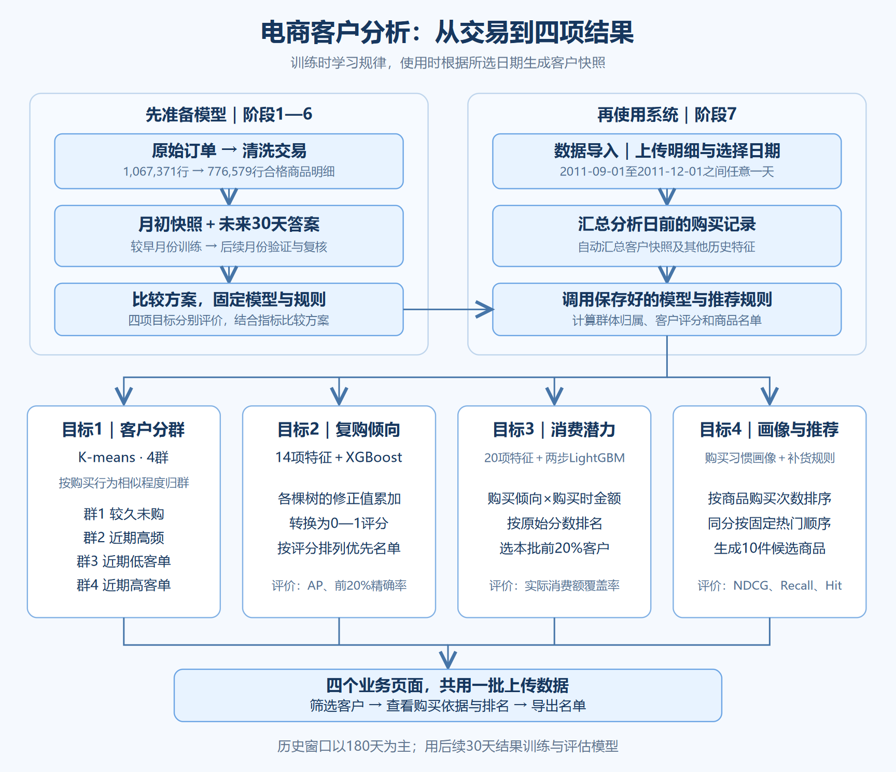

# 电商客户分析项目学习指南

这份指南从订单数据开始，按顺序说明系统怎样认识客户、预测复购、排列消费潜力，再推荐商品。先理解每一步为什么存在，再看模型和指标，就容易把整个方案连起来。

## 先看全貌：我们想帮助商家回答什么？

一家零售商已经积累了很多订单。运营人员想进一步知道：客户有什么购买特点？谁更可能再买？谁可能带来更多消费？给他推荐哪些商品？这对应项目的四个目标。

| 目标 | 回答的问题 | 页面提供的结果 |
| --- | --- | --- |
| 客户分群 | 哪些客户的购买习惯相近？ | 四个客户群，以及各群的购买特点。 |
| 未来30天复购预测 | 哪些客户更可能再次购买？ | 复购倾向评分和优先名单。 |
| 高消费潜力排序 | 哪些客户未来30天的消费潜力较高？ | 客户排名及前20%关注名单。 |
| 画像与商品推荐 | 客户倾向补货还是尝新，下一单可能买什么？ | 购买习惯画像，以及10件候选商品。 |

它面向商家的运营或客户分析人员。输入是购买记录，输出是供业务人员查看和导出的名单。

下面分七个阶段讲解。前面三个阶段为四项目标准备共同的数据；之后分别介绍算法和评分；最后把它们接入同一个页面。

## 阶段1｜认识数据，确定分析对象

项目使用 **UCI Online Retail II**：一家英国零售商的真实交易，覆盖 **2009-12-01至2011-12-09**，其中包括批发客户。

| 原始文件 | 商品明细行数 |
| --- | ---: |
| online_retail_II_2009-2010.csv | 525,461 |
| online_retail_II_2010-2011.csv | 541,910 |
| 合计 | **1,067,371** |

两份文件都有8个字段：发票号、商品编号、商品名称、数量、购买时间、单价、客户ID和国家。

先理解这里“一行”的含义：**一行是一张发票中的一种商品明细。** 同一张发票买了两种商品，通常会有两行；同一客户多次购物，还会出现在许多张发票里。因此，这106万行统计的是商品明细条数。

项目主要分析有客户ID、且分析日前180天至少有一次合格购买的客户。

系统根据这些购买记录，了解客户买得勤不勤、每次花多少、喜欢重复购买还是尝试新商品，再生成客户和商品名单。

## 阶段2｜把交易清洗成可以使用的购买记录

明确数据单位后，下一步是整理出正常商品购买记录，作为计算订单次数和消费金额的基础。

清洗按以下顺序完成：

1. **合并两份CSV，统一格式。** 把日期、客户ID、数量和价格整理成一致的形式。
2. **去除完全重复行。** 同一发票里的不同商品分别保留。
3. **筛选合格购买。** 排除缺客户ID、取消订单、非正数量或价格，以及邮费、测试记录等非商品项目。
4. **核对清洗前后数量。** 保存排除原因，确认每一行都有去向。

最终从 **1,067,371行**中保留 **776,579行合格商品交易**，排除 **290,792行**。金额按“数量×单价”计算，再按客户、发票和时间汇总。

## 阶段3｜把交易整理成快照，再制作训练答案

清洗后的数据仍然是一行行商品购买。模型要比较客户，需要把同一客户分散的交易汇总到一起。

### 3.1 客户快照是什么？

**客户快照，就是某位客户在某一天的购买状态汇总，每位客户一行。** 例如分析日期为12月1日，就只查看此前已经发生的交易，再计算购买次数、消费额等信息。

下面是客户 **12347在2011-12-01**的真实基础快照。8项指标都是模型可用的历史信息。

| 基础特征 | 该客户的值 | 怎样得到 |
| --- | ---: | --- |
| 距上次购买天数 | 31天 | 分析日距离最近购买日期的自然日数。 |
| 过去180天订单数 | 3单 | 统计不同的合格发票。 |
| 过去180天消费额 | £2,261.75 | 把这段时间的商品行金额相加。 |
| 平均每单金额 | £753.92 | £2,261.75÷3，保留两位小数。 |
| 过去180天商品种数 | 61种 | 统计买过的不同商品编号。 |
| 最近30天订单数 | 0单 | 只统计分析日前30天内的合格发票。 |
| 最近90天订单数 | 1单 | 只统计分析日前90天内的合格发票。 |
| 客户可见历史天数 | 396天 | 分析日距离数据中首次可见购买的自然日数。 |

以12月1日为例，过去180天是 **2011-06-04至2011-11-30**。首次购买时间、累计历史消费等信息还会用到更早记录，所以实际使用时需要提供完整可用历史。

这8项是共同的基础特征。在此基础上，复购模型补充购买节奏等信息，消费潜力模型补充分时段金额，后面会分别解释。

### 3.2 标签是什么？

有了历史状态，还需要告诉训练模型“之后实际发生了什么”。这份事后答案叫标签。

| 任务 | 用什么作为答案 |
| --- | --- |
| 复购预测 | 此后30天至少有一次合格购买记为1，否则记为0。字段名是 repurchase_30d。 |
| 消费潜力排序 | 此后30天的实际合格消费总额；没有购买就是0。 |
| 商品推荐 | 此后30天内，客户下一笔订单中出现的不同商品。 |
| 客户分群 | 根据历史特征的相似程度分组。 |

要记住：**快照描述此前的情况，标签记录此后的结果。** 训练时，模型学习快照与标签之间的关系；预测时，根据新的快照输出评分；评估时，再用真实标签核对预测结果。

### 3.3 训练、验证、测试如何安排？

离线建模时，我们每月1日生成一批快照，用较早月份学习，再用之后月份比较方案。共得到 **54,040条客户月快照，涉及5,622位客户**；同一客户可以跨月出现。

训练总表有15个字段：8项基础特征、1个复购标签，以及6个日期、客户标识等辅助字段。每一行仍是一位客户在一个时点的记录。

| 数据分区 | 快照月份 | 快照数 | 主要用途 |
| --- | --- | ---: | --- |
| 训练集 | 2010年6月—2011年5月 | 37,019 | 让模型学习规律。 |
| 验证集 | 2011年6—8月 | 8,146 | 比较特征、模型和参数。 |
| 测试集 | 2011年9—11月 | 8,875 | 在方案确定后检查结果。 |

例如预测10月1日起未来30天，系统把9月已经发生的购买记录汇总进10月快照，再交给保存好的模型评分。**每次分析会更新客户状态，使用的是已经训练好的模型。**

下文将9—11月的结果称为“测试期复核”，用于展示固定方案在这三个月的表现。各项指标由对应分区的预测结果与真实交易计算得到。

## 阶段4｜比较分群方法，认识四类购买状态

有了客户快照，先根据已有购买特征，找出行为相似的客户，这就是分群。

### 4.1 用什么信息、比较什么算法？

分群采用5项信息：最近购买间隔、过去180天订单数、平均每单金额、商品广度比，以及最近90天订单占比。其中：

- **商品广度比＝过去180天不同商品数÷订单数**，用来概括客户的购买广度。
- **最近90天订单占比＝最近90天订单数÷过去180天订单数**，反映购买是否集中在近期。

不同指标的数值大小差别很大。先压缩特别大的数值，再统一量纲，让各项特征在相近尺度上参与分群。比较时，三种算法使用同样的信息。

| 算法 | 怎样分群 | 为什么比较它 |
| --- | --- | --- |
| K-means | 为每群找到一个中心，把客户分到最近的中心。 | 适合数值型购买特征，群体中心容易解释。 |
| 二分K-means | 先分成两群，再逐步拆分。 | 检查层层细分是否比一次分成多群更稳定。 |
| GMM | 用多个分布描述客户，计算客户属于各群的程度。 | 检查大小、形状不同的群体是否更适合数据。 |

每种算法都尝试 **2—6群**。评估时按客户留出一部分数据，再换几批训练客户重复分群，观察结果是否稳定。

### 4.2 怎样评价，为什么选4群？

轮廓系数同时看两件事：一个客户与本群客户是否接近，与其他群客户是否有距离。计算式是 **(b−a)÷max(a,b)**：a为它与本群客户的平均距离，b为它与最近的其他群客户的平均距离，最后对评估客户取平均。

它的范围是 **−1至1，越大通常越好**；接近0表示边界不清楚。稳定性则用ARI：比较两次分群时，客户两两之间“同群或异群”的关系有多少保持一致，再扣除随机分组也会产生的巧合。ARI为1表示完全一致，接近0约等于随机一致，也可能为负。除这两项分数，还要看每群人数和画像能否解释。

| 比较方案 | 轮廓系数 | 稳定性ARI |
| --- | ---: | ---: |
| K-means，2群 | 0.3580 | 1.0000 |
| K-means，3群 | 0.3227 | 0.9883 |
| **K-means，4群** | **0.3056** | **0.9525** |
| 二分K-means，4群 | 0.2885 | 0.9487 |
| GMM，4群，较好的轮廓结果 | 0.2195 | 0.8047 |

2群主要区分“较久未购”和“近期买过”，轮廓系数最高。4群进一步分出近期客户中购买次数、单笔金额等差别；同为4群时，K-means也更稳定、分离更清楚。5—6群的划分更细，轮廓系数约为0.266。综合比较后，4群兼顾了细分程度、稳定性和解释的方便程度。

因此最终采用 **K-means、4群**：这是细分程度与稳定性的折中。

### 4.3 页面上的群名怎样理解？

| 页面群名 | 主要特点 |
| --- | --- |
| 群1：较久未购 | 距离上次购买较久。 |
| 群2：近期高频 | 最近仍有购买，订单次数相对较多。 |
| 群3：近期低客单 | 最近有购买，平均每单金额相对较低。 |
| 群4：近期高客单 | 最近有购买，平均每单金额相对较高。 |

**算法先根据多项特征分群，再由人根据画像命名。** 群名概括各群的主要特点，客户的群体归属会随购买状态变化。

分群时比较客户与各中心的距离，通常是把标准化后每项差值的平方相加，再选择距离最小的群体。

这里有两个不同的消费指标：**累计消费看一段时间总共花了多少，客单价看平均每单花多少。** 高频客户订单多，半年累计消费可能更高；高客单群的特点是平均每单金额较高。页面占比则是 **该群客户数÷本批客户总数**。

## 阶段5｜训练复购模型，得到评分和优先名单

分群已经告诉我们客户有哪些购买特点。接下来要回答“谁更可能在未来30天再买”，就要让模型学习历史特征与真实复购标签的关系。

### 5.1 比较哪些特征和模型？

我们先比较三组输入，检查增加的信息是否有帮助。

| 特征组 | 包含什么 | 为什么增加 |
| --- | --- | --- |
| 基础8项 | 阶段3列出的购买特征。 | 作为统一起点。 |
| 基础＋趋势，共11项 | 增加近期订单占比、下单节奏变化、历史是否够90天。 | 同样买过几单，近期增加还是减少可能不同。 |
| 基础＋趋势＋规律，共14项 | 再加过去半年活跃的30天时段数、最后两次购买间隔及其有效标记。 | 区分规律购买、偶尔集中下单等情况。 |

这些新增信息均由分析日前的购买明细计算。每组输入分别比较四种模型，共12个组合。

| 模型 | 容易理解的原理 | 在比较中的作用 |
| --- | --- | --- |
| 逻辑回归LR | 给不同特征学习权重，合成评分。 | 检查简单的特征加权是否已经足够。 |
| 样条逻辑回归 | 允许最近购买时间的影响平滑变化。 | 例如“隔5天到10天”与“隔100天到105天”的影响未必相同。 |
| XGBoost | 用一棵棵小树逐步修正预测。 | 学习购买次数、时间和金额之间的组合关系。 |
| LightGBM | 另一种逐步增加小树的GBDT实现。 | 比较两种建树方式对本项目数据的适用性。 |

先在训练期内部按时间向前验证，挑选模型复杂度，再用6—8月比较最终组合。我们的数据是数值型表格，购买行为可能存在非线性关系，因此从简单加权到小型树模型逐步比较，观察各类模型学习购买规律的效果。

| 使用14项特征的模型 | 验证AP | 前20%名单精确率 |
| --- | ---: | ---: |
| LR | 0.5931 | 60.02% |
| 样条LR | 0.5953 | 60.58% |
| LightGBM | 0.5997 | 60.33% |
| **XGBoost** | **0.6009** | **60.64%** |

最终选择 **14项特征＋XGBoost**。选型同时参考向前验证AP和前20%精确率，并与基础LR比较。XGBoost与LightGBM的验证AP接近，相差约0.0013，XGBoost在本轮比较中略高。

### 5.2 模型给客户的分数怎样得到？

XGBoost里的每棵树都会根据客户特征走到一个叶子，给出一个训练时学到的修正值。模型把这些修正累加，再转换成0—1之间的分数：

**原始总分F＝起始值＋各棵树修正值的加权和；复购评分s＝1÷(1＋exp(−F))。**

最后这一步把原始总分转换到0—1之间：F为0时得0.5，F越大，评分越高。理解时先抓住“各棵树学习修正，再合成评分”即可。

这些树的判断条件和叶子数值，都是用训练样本和0/1标签学习出来的。

例如客户12347在2011-12-01的评分约为 **0.3326**。这是用于客户排序的复购倾向评分：分数越高，模型判断的复购倾向越强。页面按连续评分排列客户，帮助用户确定查看顺序。

### 5.3 怎样判断评分是否有用？

模型打完分后，先按分数降序排列客户，再拿真实标签核对。以9—11月测试期复核为例：共有8,875条客户月快照，真实复购3,025条；每月取前20%，共1,776个名额，XGBoost命中1,176条。

| 指标 | 怎样计算、说明什么 | 范围／好的方向 | XGBoost结果 |
| --- | --- | --- | ---: |
| AP | 按不同分数阈值逐步扩大名单，把“召回率增加量×该阈值精确率”相加，评价整张排序。 | 0—1，越大越好 | **0.6201** |
| ROC-AUC | 随机取一条复购和一条未复购记录，比较是否把复购者排得更高；同分算半次正确。 | 0—1，越大越好；0.5约等于随机 | **0.7204** |
| Precision@20% | 名单中实际复购数÷名单人数；本次为1,176÷1,776。 | 0—100%，越大越好 | **66.22%** |
| Recall@20% | 名单中实际复购数÷所有实际复购数；本次为1,176÷3,025。 | 0—100%，越大越好 | **38.88%** |
| Lift@20% | 名单复购率÷总体复购率；总体为3,025÷8,875＝34.08%。 | 0及以上，越大越好；1表示与总体相同 | **1.943倍** |
| Brier | 每条记录计算“(评分−真实0/1答案)的平方”，再取平均，检查分数与结果的接近程度。 | 0—1，越小越好 | **0.1928** |

AP再用一个小例子理解：假设5位客户从高分到低分的真实结果是 **1、0、1、1、0**，且没有同分。三个复购客户出现在第1、3、4名，相应精确率是1、2/3、3/4。AP＝**(1＋2/3＋3/4)÷3≈0.8056**。越早把复购客户排出来，AP通常越高；实际程序对同分记录按同一阈值计算。

基础8项LR在同样数据上的AP为 **0.6064**，前20%精确率为 **63.96%**，相同名额命中1,136条。XGBoost多命中40条客户月记录，说明排序有所改善。这里按“客户×月份”统计，同一客户在不同月份分别计为一条记录。

这些指标各有侧重：AP看整体排序，前20%精确率看有限名额的质量，召回率看覆盖了多少真正复购者，Brier看分数与答案的距离。合在一起，才能判断名单和分数的表现。

## 阶段6｜进一步判断消费潜力，并推荐商品

在复购倾向的基础上，我们进一步分析客户可能带来多少消费、下一单可能买什么，这对应消费潜力排序和商品推荐两个配套目标。

### 6.1 高消费潜力：按未来30天消费能力排序

这里使用 **20项历史特征**：基础8项，再增加近30／60／90天金额、最近一单和最大一单金额、活跃购买天数、累计历史消费等12项。答案是客户随后30天实际花了多少钱。

比较包括两类方法：

| 方法 | 思路与比较理由 |
| --- | --- |
| 过去30／90／180天金额排序 | 直接按近期消费排名，是业务上容易使用的对照。 |
| LightGBM与XGBoost直接金额模型 | 用树学习未来金额；采用适合零消费较多、正金额偏斜数据的Tweedie目标。 |
| 两步LightGBM | 先估计是否购买，再估计购买时的金额，分别处理“不买”和“买多少”。 |

最终选择 **两步LightGBM**。它内部有自己的购买模型，与复购页面的XGBoost独立。第一步得到购买倾向估计p，第二步得到购买时消费额估计m，再计算 **消费潜力原始分数＝p×m**。

例如模型估计p为0.6、m为£500，相乘得到£300。**这300是模型对未来30天消费额的期望估计**。系统按这个值从高到低排列客户，页面展示由此得到的消费潜力名次。

排序后每批取前20%，核心评价指标是：

**消费额覆盖率＝前20%客户随后30天的实际消费总额÷本批所有客户同期实际消费总额。**

它在0—100%之间，越大表示相同名额覆盖的实际消费越多。

假设100位客户之后实际共消费£10,000，模型选出的20位实际消费£7,000，覆盖率就是70%。

| 方法 | 6—8月验证覆盖率 | 9—11月复核覆盖率 |
| --- | ---: | ---: |
| 过去180天金额规则 | 71.37% | 67.45% |
| 过去90天金额规则 | 67.39% | 64.56% |
| 过去30天金额规则 | 56.14% | 55.95% |
| LightGBM直接金额模型 | 73.01% | 70.23% |
| XGBoost直接金额模型 | 72.80% | 70.45% |
| **两步LightGBM** | **73.28%** | **70.23%** |

上表均先逐月计算，再对三个月等权平均。两步模型在验证期相对最强金额规则提高 **1.91个百分点**，逐月表现和重抽客户检查也满足选型条件，因此采用它。方案依据6—8月验证结果确定，再用9—11月检查表现，相对金额规则提高约 **2.78个百分点**。

方案选定后，用9月1日前答案已完整观察的训练、验证样本拟合消费排序的最终模型。MAE也作为辅助指标：先逐客户计算预测金额与实际金额之差，取绝对值，再对客户取平均。也就是 **MAE＝所有客户的绝对金额误差之和÷客户数**，取值为0及以上，以英镑计，越小越好。最终两步模型复核MAE为£253.75，金额规则为£263.47；规则计算金额误差时，用过去180天消费额÷6换成30天的估计。**MAE看金额估计的误差，消费额覆盖率看优先名单覆盖了多少实际消费。**

### 6.2 画像与商品推荐：理解买什么，再生成Top10

同样的订单记录还可以形成购买习惯画像。这里先把一张订单里重复的商品合并；同一客户同一时刻的购买视为一次购买。

“补货倾向”主要看后续订单里，多少商品以前买过。例如第一单买A、B；第二单买A、C，重复比例为1/2；第三单买A、B，比例为2/2。首次订单用于建立历史，不参与平均，最终历史重复比例为 **(50%＋100%)÷2＝75%**。

页面还显示购买次数、商品种数和常购商品集中度。其中 **常购商品集中度＝购买次数最多的3种商品的累计出现次数÷所有商品累计出现次数**。这些指标一起描述客户的购买习惯，页面同时显示订单记录数量，方便理解画像的依据。

有了画像和购买记录，再比较推荐方法：

| 方法 | 怎样推荐 | 为什么比较 |
| --- | --- | --- |
| 热门商品 | 向客户提供整体热门商品。 | 展示按整体商品热度推荐的效果。 |
| 个人重复购买 | 优先推荐该客户过去180天多次买过的商品。 | 数据包含重复补货和批发购买，这是有竞争力的业务规则。 |
| ItemKNN | 找到经常被相同客户购买的相似商品。 | 利用商品之间的购买关系。 |
| 隐式反馈ALS | 从“谁买过什么”学习客户偏好和商品特征。 | 将购买行为作为偏好信号，适合本项目的交易数据。 |
| EASE | 学习商品之间的整体关联。 | 作为适合稀疏购买记录的另一种推荐模型。 |

所有方法为相同客户推荐10件商品，使用相同候选商品库，再核对客户随后30天内下一笔订单买了什么。在统一的客户、候选商品和时间范围下，比较各方法的表现。

前面比较的是不同推荐方法。接下来，我们把任务进一步细化：**给“某位客户＋某件商品”打分，再为该客户选出分数最高的10件商品。** 训练答案是这件商品是否出现在客户随后30天内的下一笔订单中；输入只使用分析日前已经发生的购买记录。

为了检查“客户画像”和“商品关联”各自带来的作用，实验设置以下四组输入。**A、B、C、D表示给模型提供的四组信息。**

| 组别 | 给模型哪些信息 | 简单例子 |
| --- | --- | --- |
| **A：基础组（15项）** | 客户买没买过这件商品、买过几次、多久没买、购买间隔，以及商品热度等。 | 客户过去买过这款杯子3次，距上次购买20天。 |
| **B：基础＋画像（31项）** | A组＋10项购买习惯画像＋6项组合特征。画像包括重复购买比例、常购商品集中度、近期变化等。 | 同样买过杯子3次，经常重复购买的客户，与经常换新品的客户，推荐依据可能不同。 |
| **C：基础＋EASE（17项）** | A组＋EASE关联得分和“是否缺少关联信号”的标记。 | 客户没买过这款碟子，但买过与它有关联的杯子，EASE会提供一个关联分数。 |
| **D：完整组（34项）** | A组＋B组新增的画像与组合特征＋C组新增的EASE信号，再加“重复购买比例×EASE得分”。 | 同时考虑客户是否常补货、这件商品买过几次，以及其他商品的购买关系是否支持推荐它。 |

这里的“组合特征”，就是把两条信息一起考虑。例如“重复购买比例×是否买过这件商品”，让模型把客户的总体习惯与具体商品联系起来。D组在一份基础信息上，汇总画像、EASE信号及相关组合特征。

四组分别使用 **LR、LightGBM分类、LightGBM排序**，因此共比较 **4×3＝12个组合**。C、D组中的EASE先提供关联得分，再由这三类模型学习最终的商品排序；这与前面“直接按EASE得分推荐”是两种用法。

比较时使用相同客户、训练样本、候选商品和评价月份，同类模型的四组使用相同参数。**B与A、D与C比较，检查加入画像的作用；C与A、D与B比较，检查加入EASE相关信息的作用。** 商品是否买过、客户订单数量和画像缺失情况，也会在整理特征时一并记录。

当前采用 **个人重复购买规则**。每件商品的主分数是 **过去180天，该客户购买它的不同发票次数**。同分按冻结商品库中的热门顺序处理，推荐数量不足10件时用热门商品补齐。页面将购买习惯画像与商品名单一起展示：画像帮助理解客户，购买次数决定默认名单的商品优先级。

例如A商品买过3次、B商品买过1次，就优先推荐A。这里的分数3来自客户购买A商品的发票次数。

### 6.3 推荐效果怎样计算？

| 指标 | 怎样计算、说明什么 | 范围／方向 |
| --- | --- | --- |
| Recall@10 | 推荐命中的不同商品数÷下一单实际不同商品数。 | 0—100%，越大越好。 |
| Hit@10 | 某客户至少命中1件记1，否则记0，再对客户取平均。 | 0—100%，越大越好。 |
| NDCG@10 | 命中商品按名次给予不同权重，再除以理想顺序得分。 | 0—1，越大越好。 |
| 未买商品Recall@10 | 命中的未买商品数÷下一单实际未买商品数；“未买”指此前180天没买过。 | 0—100%，越大越好。 |

例如推荐10件，下一单实际买4种商品，命中2种，则Recall@10＝2÷4＝50%，这个客户的Hit@10＝1。

NDCG还考虑顺序：第r名命中的贡献为 **1÷log₂(r＋1)**，未命中为0。前10名贡献相加得到DCG，再除以“把答案尽量放在最前面”能得到的理想DCG。例如下一单只买A，A排第1名得1，排第3名得0.5；这时理想DCG为1，所以NDCG分别为1和0.5。

| 方法 | 验证NDCG@10 | 验证Recall@10 | 验证Hit@10 |
| --- | ---: | ---: | ---: |
| 热门商品 | 0.1270 | 6.64% | 55.45% |
| 个人重复购买 | 0.3226 | 20.01% | 80.60% |
| ItemKNN | 0.2015 | 11.65% | 63.16% |
| 隐式反馈ALS | 0.2526 | 14.87% | 72.73% |
| EASE | 0.2779 | 16.81% | 75.80% |
| 后续最佳商品模型：完整信息＋LightGBM分类 | 0.3448 | 21.21% | 82.66% |

完整信息＋LightGBM分类的整体指标更高。“未买商品召回”从 **0.173%提高到0.628%**，增加约0.455个百分点；切换默认方案的目标是至少增加1个百分点。因此，系统当前采用个人重复购买规则，保留商品模型的实验结果供后续改进。

默认规则在9—11月复核的 **NDCG@10为0.2863、Recall@10为17.17%、Hit@10为75.09%**。其中75.09%表示约四分之三的客户至少命中一件商品，统计单位是客户。上述主指标在未来30天有下一单的客户上计算，先在每月对客户取平均，再对三个月等权平均；所有符合条件的客户都会得到推荐名单。

## 阶段7｜把四项分析连成一个可使用的系统

前面的比较用于确定模型和规则。到了实际页面，侧栏先提供“数据导入”，其下是四项客户分析。用户在“数据导入”上传购买明细、选择日期；系统调用保存好的方案，完成计算并展示结果。

现在支持 **2011-09-01至2011-12-01之间任意一天，包含首尾**。离线训练样本按月初制作，页面分析时则按用户选择的日期生成快照并评分。

整个使用流程可以连起来理解：

**上传完整购买明细 → 选择分析日期 → 提取分析日前的交易 → 生成客户快照和其他历史特征 → 调用模型与推荐规则 → 查看四项结果 → 筛选、导出名单。**

演示文件为purchase_history.csv，包含 **759,615条真实合格交易**，从2009-12-01到2011-11-30。文件保留此前完整可用历史，系统自动提取各项特征所需的时间窗口。选择2011-12-01时，生成 **3,444位客户**的快照，高消费潜力前20%名额为 **向上取整(3,444×20%)＝689位**。

这份明细用于计算12月1日的客户状态，再由已经保存的模型和规则生成复购评分、消费潜力排名及商品推荐。12月示例展示的是上传明细到生成四项分析的完整使用流程。

| 页面 | 看到的数字是什么 | 怎样使用 |
| --- | --- | --- |
| 客户分群 | 群体归属、人数、占比和历史购买统计。 | 理解不同客户的购买状态。 |
| 复购优先名单 | XGBoost评分及当前筛选结果中的名次。 | 优先查看复购倾向较高的客户。 |
| 高消费潜力 | 由两步LightGBM分数生成的本批客户排名。 | 查看前20%名单；筛选后仍保留整批排名。 |
| 画像与商品推荐 | 购买习惯统计、商品购买次数及10件候选商品。 | 理解推荐依据，导出商品名单。 |

其中，群体占比＝群人数÷本批人数；复购分数按高到低排序；消费潜力保留本批客户中的整体排名。导出的业务名单和页面当前可见结果一致。

页面地址为 **http://localhost:8501**。首次进入“数据导入”，生成分析后自动进入“客户分群”，四项分析入口同时可用。之后可随时点击侧栏“数据导入”更换明细或日期，再点击“生成分析”；成功后四个页面一起使用新结果。返回导入页时会保留已有分析，也可以直接返回当前结果继续查看。

需要进一步核对时，可查阅[上传数据使用说明](上传数据使用说明.md)和项目中对应的模型比较结果。
