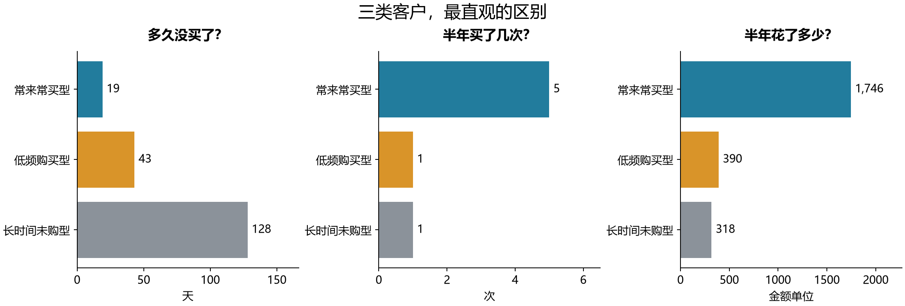
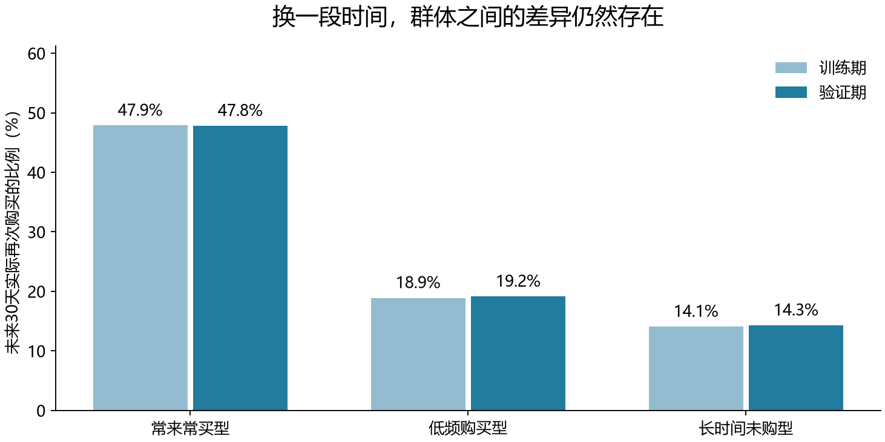

# 客户分群：谁在常买，谁只是偶尔来，谁已经很久没买？

> 本报告要回答的是客户之间有哪些值得关注的差别，以及这些差别能给后续分析带来什么。

## 先看最值得讲的三个发现

1. **常买的人不一定每笔都特别贵。** 常来常买群的半年购买次数约是低频群的 5.0倍，但典型单笔金额仅约 1.5倍。购买频次是两群之间很突出的差别。
2. **单笔花得多，近期也未必活跃。** 分成四群时，有一群典型单笔金额为 417，高于最频繁购买群的 345；但距上次购买分别为 53天和13天。
3. **最近买得多，不等于下个月一定继续买。** 新增的“购买节奏变化”特征发现了一个反直觉现象，后文给出具体对照。

阅读口径：一个客户每个月记一条记录，称为“客户月记录”。同一个人可能在不同月份属于不同群体。除特别说明外，画像使用训练期（2010年6月—2011年5月）记录；“典型值”指中位数，也就是排序后居中的数。金额沿用原始 CSV 的单位。

## 1. 分成三群，分别是什么样的人？

**k 就是想分成几群。k=3 表示分成三群；C0、C1、C2 只是编号，没有高低顺序。**

| 群体 | 记录占比 | 距上次购买 | 半年购买次数 | 半年消费金额 |
| --- | --- | --- | --- | --- |
| 常来常买型（C1） | 27.3% | 19天 | 5次 | 1,746 |
| 低频购买型（C2） | 40.1% | 43天 | 1次 | 390 |
| 长时间未购型（C0） | 32.6% | 128天 | 1次 | 318 |



### 常来常买型：核心特点是常买，买的商品也更多

这群人典型的半年购买次数为 **5次**，购买过 **74种商品**；低频群分别为 1次、23种。典型单笔金额为 **378**，低频群为 **253**。这更像一群持续购买、接触商品较广的客户。单笔金额是每位客户平均订单金额的中位数，不能把几个中位数直接相乘。

再看一个不重复计算客户的例子：**2011年05月01日**，这群只有 **837人**，占当日客户 **27.5%**，却占这些客户过去180天消费金额的 **73.2%**。这个比例说明维护其购买连续性值得关注；它是该日客户范围内的消费份额。

### 低频购买型：人数多，尚未形成频繁购买习惯

这群占全部记录 **40.1%**，其中 **52.3%** 在过去半年只买过一次；**15.0%** 的首次可见购买在最近30天内。因此，这一群同时包含最近才出现在数据中的客户，以及买得不频繁的老客户。

**可以继续追问：** 对只有一次购买记录的人，哪些历史行为与第二次购买相关？“首次可见购买”是数据里的第一次购买记录，不能直接当作真实注册时间。

### 长时间未购型：主要区别是沉默时间长

这群距上次购买典型已有 **128天**，**94.9%** 的记录在过去90天没有购买。但其典型单笔金额 **266**，与低频群的 **253** 接近。用“长时间未购买”描述它，比只贴“低价值”标签更准确。

**可以继续追问：** 长时间未购的人是否存在不同的补货周期？现有快照没有完整订单间隔和商品类别，暂时只能提出这个待验证问题。

## 2. 为什么还要看四群、五群、六群？

多分几群，是把画像看得更细。它会重新划分全部客户，所以四群方案不等于简单地把三群中的某一群劈开。

表里的“分离程度”对应轮廓系数：越高，表示同群客户更相似、不同群体更容易分开。它不是准确率。

| 方案 | 分离程度 | 最小群占比 | 比总览多看到了什么 |
| --- | --- | --- | --- |
| 3群 | 0.2242 | 27.3% | 建立总体轮廓：常来常买、低频购买、长时间未购。 |
| 4群 | 0.2234 | 17.1% | 出现“高单笔、低频”群：典型单笔417，半年买2次，距上次购买53天。 |
| 5群 | 0.2034 | 12.9% | 识别一批低消费、购买商品种类少的客户：半年金额129，商品种类7种。 |
| 6群 | 0.2074 | 7.1% | 高频客户继续细分：最频繁一群半年买9次，占7.1%；也分开了消费接近、近期活跃不同的群体。 |

**当前主模型沿用 3 群。** 三群与四群得分只差 0.0007，所以不能说三群明显胜出。三群适合讲总体结构；四群提供了有价值的业务细节，值得在展示中保留。五群、六群可作为更细的观察视角，分离程度并未持续改善。

### 四群方案中，值得单独讲的“高单笔、低频”群

| 四群方案中的群体 | 记录占比 | 距上次购买 | 半年购买次数 | 典型单笔金额 |
| --- | --- | --- | --- | --- |
| 频繁购买型（C2） | 17.1% | 13天 | 6次 | 345 |
| 高单笔、低频型（C1） | 27.8% | 53天 | 2次 | 417 |
| 低频、可见历史较短型（C0） | 26.6% | 35天 | 1次 | 202 |
| 长时间未购型（C3） | 28.6% | 131天 | 1次 | 231 |

“高单笔、低频型”占 **27.8%**，典型半年消费金额为 **987**。这提示我们：消费金额高可以来自“买得频繁”，也可以来自“每笔买得较多”。两类客户是否适合相同的维护节奏，需要进一步研究。

六群方案还发现一对值得对比的群体：两群半年都买了约 **3次**，金额也接近（**1,027 / 1,024**），但距上次购买分别为 **14天 / 55天**。它们过去的消费规模相似，当前所处的购买阶段却不同。这是只按消费总额分层容易忽略的差别。

## 3. 新挖掘了哪些特征？

原来的特征告诉我们“买了多少”。这次补充“最近有没有改变、在有限历史里买得有多频繁”。这些特征由现有字段计算，属于新的表达方式；真实订单间隔、品类偏好、退货偏好仍需要交易明细。

| 新增特征 | 通俗含义与算法 | 怎么理解 |
| --- | --- | --- |
| 购买节奏变化 | 最近30天购买次数 − 再往前60天的月均购买次数 | 例如最近30天买3次、前60天共买2次，变化为 +2。只给已有至少90天可见历史的人计算。 |
| 近期购买占比 | 最近90天购买次数 ÷ 最近180天购买次数 | 接近1：半年内的购买集中在较近一段；为0：最近90天没有买。短历史客户天然可能偏高。 |
| 按可见历史折算的月购次数 | 半年购买次数 ÷ 可见历史天数 × 30；天数限定30—180天 | 同样买2次，出现了两个月与出现了半年，购买频率应区别看待。 |
| 历史是否足够长 | 是否已有至少90天可见购买历史 | 提示节奏变化是否有足够观察时间，避免把缺少历史当成没有购买。 |

另外增加了两个便于找人的标记：**近期加速**＝节奏变化至少增加1次/月；**重复购买后暂时中断**＝已有90天可见历史、过去90天买过至少2次，但最近30天没有买。

### 新特征真的让分群更好吗？实际试了一遍

将上述4项加入原有8项后，再比较3—6群。新增特征方案选择了 **3群**。它单独识别出一个占 **20.1%** 的群体，首次可见购买距今典型只有 **48天**，其中 **98.5%** 的可见历史不足90天。说明新增特征让模型更强调“客户处在什么观察阶段”。

用新增后的12项特征衡量，新方案得分 **0.3145**。但衡量的“尺子”变了，不能直接拿这个数与原来的得分比较。重新用原来8项特征衡量同为 3 群的新分法，得分为 **0.2056**，原方案为 **0.2242**。因此，现阶段的收获是找到了新的观察维度，还没有证据说明应该用新方案替换原模型。

## 4. 这些特点换一段时间还成立吗？

用原模型给2011年6—8月的客户分群，再看他们之后30天实际有没有再次购买。以下结果只用于事后检查画像，未来购买记录没有参与分群。

| 群体 | 训练期实际复购比例 | 验证期实际复购比例 |
| --- | --- | --- |
| 常来常买型 | 47.9% | 47.8% |
| 低频购买型 | 18.9% | 19.2% |
| 长时间未购型 | 14.1% | 14.3% |



常来常买群在三个验证月份的复购比例为 **47.4%—48.5%**，长时间未购群为 **12.1%—16.3%**。这种差异在三个验证月份都存在，说明画像有后续行为上的对应。也说明“很久没买”不等于以后再也不会买。

### 一个反直觉发现：近期加速，不一定持续加速

在 **常来常买型** 内，只比较可见历史满90天的记录：

| 验证期子组 | 客户月记录数 | 之后30天实际复购比例 |
| --- | --- | --- |
| 最近购买次数明显增加 | 769 | 40.8% |
| 没有达到上述增加幅度 | 1,787 | 50.8% |

这个结果提醒我们：购买有节奏，最近的集中购买未必会持续到下个月。是否与集中补货、季节性或客户构成有关，当前数据还不能确认。可以把“购买节奏变化”交给阶段五模型检验，而不能直接写成“越活跃越容易复购”。

### 另一个细节：暂时没买的人，也可能仍有购买基础

在 **低频购买型** 中，“重复购买后暂时中断”的记录有 **190条**，验证期之后30天复购比例为 **32.1%**；同群其余可见历史满90天的记录为 **18.1%**（1,550条）。

这个标记同时包含“过去买过不止一次”和“最近暂停”，所以较高复购率可能来自既有的购买基础。它适合用来区分客户状态，尚不能据此把“暂停”解释为复购的原因。

以上属于探索性观察。同一客户可贡献多个月份记录，不能当作独立样本做普通显著性检验；这里的“突出特点”指可观察的差异，没有声称统计显著或营销措施有效。测试期仍留给最终评估。

## 5. 简单排序给后续预测模型定了什么参照？

假设每个月只能查看20%的客户：RFM 同时看“最近买没买、买过几次、花了多少”，作为后续预测模型的简单排序参照。

| 排序方法 | 验证期共选出的记录 | 其中之后30天再次购买 | 名单内复购比例 |
| --- | --- | --- | --- |
| 近期、次数和金额（RFM） | 1,631 | 910 | 55.8% |

后续复杂模型应该与这个简单办法比较，确认增加复杂度是否值得。这里是历史名单的回看，不代表营销活动带来了这些购买。

## 6. 汇报时可以怎么说？

> 我们先用三群抓住总体结构：常来常买、低频购买和长时间未购。然后把分群细化，发现高消费既可能来自高频购买，也可能来自较高的单笔金额；消费相似的人，近期活跃程度也可能不同。进一步构造购买节奏和可见历史特征后，发现近期加速不一定延续到下个月。因此，客户分群的价值是把这些差别说清楚，为后续复购预测提出可检验的问题。

## 数据文件与复现

- 全部合格快照 **54,040条**；训练期用于发现分群，验证期用于后续行为对照。
- 在项目根目录运行 `python stage4/kmeans.py` 重新生成分析与报告；运行 `python stage4/kmeans.py --check` 检查已有结果。
- `data/` 放结果表，`figures/` 放正文引用的两张图，`model/` 放可加载模型。

| 文件 | 内容与用途 |
| --- | --- |
| [客户结果总表](data/customer_results.csv) | 每个客户每月一行：原始特征、新特征、分群、中心距离、两种排序和前20%标记。 |
| [群体画像汇总](data/cluster_profiles.csv) | 原始与新增特征方案的各群体画像；按 feature_set、k、split 筛选。 |
| [分群方案比较](data/model_comparison.csv) | 原始8项和新增后12项特征的 k=3—6 比较，合计8个方案。 |
| [排序基线表现](data/baseline_metrics.csv) | 训练、验证期的逐月与汇总排序表现。 |
| [行为发现的依据](data/behavior_evidence.json) | 同日消费份额、购买节奏子组、按月复购对照，合在一份记录中。 |
| [模型包](model/segmentation_bundle.joblib) | 主模型、RFM切点、新特征探索模型，共用一个文件。 |
| [运行记录](run_manifest.json) | 输入哈希、版本、配置、日期划分和预处理统计。 |

画像表中，`feature_set=original_8` 是原始方案，`enhanced_12` 是新特征探索方案；`is_main_model=True` 是正文使用的主模型。`split` 区分训练、验证和测试；`snapshot_count` 是客户月记录数，`snapshot_share` 是占比，`_median` 是中位数，`_mean` 是均值。测试期的实际复购比例留空。

<details>
<summary>方法与模型使用说明（点击展开）</summary>

**训练边界。** 沿用上游时间划分，填补、变换和缩放只在训练期拟合；客户ID、日期和未来标签不作分群输入。原始交易与最后一期观察是否完整，仍需阶段二、三的交易明细佐证。

**分群方法。** 原始8项特征以训练期中位数填补，偏度大于1的列做 log1p，再统一尺度。四个 k 使用同一批 4,000 条训练记录比较分离程度；随机种子 42，每个方案尝试20次初始中心。先要求最小群占比达到5%，再选择分离程度最高的方案。新特征方案允许购买节奏变化为负数，使用保留正负号的对数变换，独立拟合。

**排序口径。** 最近购买时间分数为距上次购买天数的相反数。RFM按训练期五分位切点计分，R反向、F/M正向，各1—5分后相加；相同值同档。每个日期分别取前20%（人数向上取整），同分按客户ID文本升序。汇总名单表现采用逐月入选记录的合计；分数是排序依据。

**加载模型。** 在项目根目录运行：

```python
import joblib
bundle = joblib.load('stage4/outputs/stage4/model/segmentation_bundle.joblib')
X = snapshots[bundle['features']]
clusters = bundle['pipeline'].predict(X)
distances = bundle['pipeline'].transform(X)
# 探索模型位于 bundle['exploratory']，输入先用 stage4.kmeans.derive_features 生成。
```

主模型中心距离位于统一尺度后的特征空间，可供阶段五使用；滚动验证应在各折训练期重新拟合。模型包中的探索模型使用 stage4.transforms 中可导入的变换函数。依赖版本记录在 run_manifest.json。

</details>
