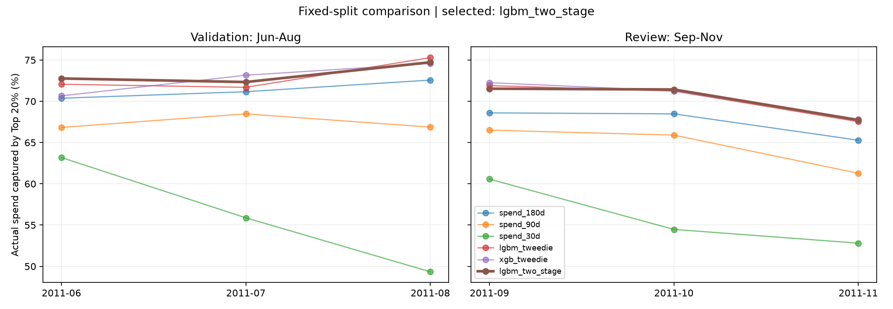

# Spending-potential sorting: unified comparison results

**Final adoption: two-stage LightGBM.** Only based on the verification results of June-August, the September-November are the review results after locking.

Goal: Select 20% customers every month and cover more subsequent 30 days of qualified consumption. All learning models share 20 known purchase features, 8 sets of parameters for each category, and 5 forward development folds.

| method | Verification: average monthly coverage | Verification: Amount sum coverage | Review: average monthly coverage | Review: Total amount coverage |
|---|---:|---:|---:|---:|
| Consumption sorting in the past 180 days | 71.37% | 71.38% | 67.45% | 67.28% |
| Consumption sorting in the past 90 days | 67.39% | 67.36% | 64.56% | 64.30% |
| Consumption sorting in the past 30 days | 56.14% | 56.11% | 55.95% | 55.70% |
| LightGBM Tweedie | 73.01% | 73.06% | 70.23% | 70.01% |
| XGBoost Tweedie | 72.80% | 72.80% | 70.45% | 70.25% |
| Two steps LightGBM | 73.28% | 73.31% | 70.23% | 70.04% |

## Why choose it?

- The strongest rule: consumption ranking in the past 180 days; the strongest learning solution: two-stage LightGBM.
- The monthly average coverage of the strongest learning solution during the validation period is + 1.91 percentage points relative to the strongest rules.
- Fixed conditions: average improvement ≥ 1 percentage points, no regression for at least 2 / 3 months, worst month lag ≤ 1 percentage points, lower bound of paired customer resampling interval > 0.
- Condition result: `{"mean_gain_at_least_1pp": true, "at_least_two_months_nonworse": true, "worst_month_loss_at_most_1pp": true, "customer_interval_lower_positive": true}`.
- If the four items are met, the learning plan that wins during the validation period will be adopted.

## Final parameters and fair comparison

All models are fitted without test labels. The verification model is only trained until 2011, and 5 months, and the final model is only trained until 2011, and 8 months; the latter has fixed scores of 9, 10, and 11 months and is not updated midway.

| Study plan | Develop selected configuration | Average monthly development coverage |
|---|---|---:|
| LightGBM Tweedie | 120 regression tree, 15 leaves, conservative | 72.18% |
| XGBoost Tweedie | 120 regression tree, 15 leaves, standard | 70.99% |
| Two steps LightGBM | 120 regression tree, 15 leaves, conservative | 72.09% |

The learning rate is 0.05, seed 42; Tweedie variance power 1.5. The number of classification trees of the two-step model is 2 / 3, the number of regression trees, and the purchase probability is multiplied by the mean value of the Gamma amount after purchase. For all specific parameters, see locked_plan.json and locked_selection.json.

## Monthly list effect

| month | Purpose | Number of customers | 20% quota | final method override | Strongest rule coverage | Difference |
|---|---|---:|---:|---:|---:|---:|
| 2011-06 | Verify | 2,658 | 532 | 72.76% | 70.37% | + 2.39 percentage points |
| 2011-07 | Verify | 2,722 | 545 | 72.33% | 71.16% | + 1.17 percentage points |
| 2011-08 | Verify | 2,766 | 554 | 74.73% | 72.57% | + 2.16 percentage points |
| 2011-09 | Review | 2,768 | 554 | 71.53% | 68.60% | + 2.93 percentage points |
| 2011-10 | Review | 2,919 | 584 | 71.43% | 68.48% | + 2.95 percentage points |
| 2011-11 | Review | 3,188 | 638 | 67.73% | 65.29% | + 2.45 percentage points |

## Robustness and usage

During the validation period, 500 times of customer group pairing resampling: the monthly average improvement of the strongest learning scheme on the strongest rule is + 1.91 percentage points, and the 95% customer sampling interval is [+ 0.48, + 2.85 ] percentage points. This is an internal diagnosis after selection and does not include the uncertainty caused by monthly changes. See seed_monthly.csv for the monthly results of the other two seeds.

Amount results from these previous months have been used in the study and new independent testing is not available for this round. Model comparison and 20% list utility and personal amount prediction accuracy are different indicators; the list percentile only represents the relative ranking of the month.

Recurrence: `python -B -m value_prediction.ranking_comparison`; Open: `python -m streamlit run app/dashboard.py` → High-value customers.

comparison.csv is the overall comparison, monthly_comparison.csv is the month-by-month comparison, tuning_comparison.csv retains all 24 group parameters; validation_predictions.csv/review_predictions.csv retains internal item-by-item ratings and real answers, customer_priority.csv is the exportable safe list, excluding future answers or personal estimated amounts.
